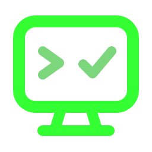

<h1 align="center">
  
</h1>

<p align="center">
  <a href="https://tui-test.dev/docs/">Documentation</a> |
  <a href="https://tui-test.dev/docs/install/">Installation</a> |
  <a href="https://github.com/microsoft/tui-test/releases">Releases</a>
</p>

`tui-test` controls, inspects, tests, and records real shell sessions and full-screen terminal apps on Windows, Linux, and macOS. It addition to it's cli, it has libraries for Rust, Python, Javascript, or Go. `tui-test` gives AI agents the ability to record videos/gifs of terminals, perform terminal operations, create end-to-end tests for terminal applications, and it exposes structured access to terminal state.

## Installation

### CLI

macOS and Linux:

```sh
curl -fsSL https://tui-test.dev/install.sh | sh
```

Windows:

```powershell
irm https://tui-test.dev/install.ps1 | iex
```

Homebrew:

```sh
brew tap microsoft/tui-test https://github.com/microsoft/tui-test
brew install tui-test
```

### Libraries

| Language | Install |
| --- | --- |
| JavaScript  | `npm install @microsoft/tui-test` |
| Python | `pip install tui-test` |
| Rust | `cargo add tui-test-rs@0.1.1` |
| Go | `go get github.com/microsoft/tui-test/bindings/go@v0.1.1` |

See the [installation guide](https://tui-test.dev/docs/install/) for runtime requirements and supported platforms.

## Examples

### CLI

```sh
tui-test --session demo run my-app
tui-test --session demo expect text "Ready"
tui-test --session demo click text "Continue"
tui-test --session demo expect text "Done"
tui-test --session demo screenshot -o result.svg
tui-test --session demo close
```

### JavaScript / TypeScript

```js
import { TuiTest } from "@microsoft/tui-test";

const terminal = TuiTest.ephemeral();

try {
  await terminal.run("my-app");
  await terminal.getByText("Ready").expect();
  await terminal.getByText("Continue").click();
  await terminal.getByText("Done").expect();
} finally {
  await terminal.closeQuiet();
}
```

### Python

```python
import asyncio
from tui_test import TuiTest

async def main():
    async with TuiTest.ephemeral() as terminal:
        await terminal.run("my-app")
        await terminal.get_by_text("Ready").expect()
        await terminal.get_by_text("Continue").click()
        await terminal.get_by_text("Done").expect()

asyncio.run(main())
```

### Rust

```rust
use tui_test::{Backend, RunOptions, Session};

fn main() -> Result<(), Box<dyn std::error::Error>> {
    let terminal = Session::new("example");
    terminal.run(RunOptions {
        program: "my-app".into(),
        args: vec![],
        backend: Backend::Alacritty,
        profile: Default::default(),
        cols: 80,
        rows: 30,
        cwd: None,
        env: vec![],
        wait_ready: None,
        restart: false,
        timeouts: Default::default(),
        recording: Default::default(),
        style: Default::default(),
    })?;
    let result = (|| {
        terminal.get_by_text("Ready").expect()?;
        terminal.get_by_text("Continue").click()?;
        terminal.get_by_text("Done").expect()
    })();
    terminal.close()?;
    result?;
    Ok(())
}
```

### Go

```go
package main

import (
    "log"

    "github.com/microsoft/tui-test/bindings/go"
)

func main() {
    terminal, err := tuitest.Ephemeral("example", tuitest.ClientOptions{})
    if err != nil {
        log.Fatal(err)
    }
    defer terminal.CloseQuiet()

    if _, err := terminal.Run("my-app", nil, tuitest.SpawnOptions{}); err != nil {
        log.Print(err)
        return
    }
    if err := terminal.GetByText("Ready", tuitest.TextSelectorOptions{}).Expect(tuitest.LocatorExpectOptions{}); err != nil {
        log.Print(err)
        return
    }
    if err := terminal.GetByText("Continue", tuitest.TextSelectorOptions{}).Click(tuitest.LocatorClickOptions{}); err != nil {
        log.Print(err)
        return
    }
    if err := terminal.GetByText("Done", tuitest.TextSelectorOptions{}).Expect(tuitest.LocatorExpectOptions{}); err != nil {
        log.Print(err)
    }
}
```

See the [documentation](https://tui-test.dev/docs/) for more examples and detailed documentation

## Contributing

This project welcomes contributions and suggestions. Most contributions require you to agree to a Contributor License Agreement (CLA) declaring that you have the right to, and actually do, grant us the rights to use your contribution. For details, visit https://cla.opensource.microsoft.com.

When you submit a pull request, a CLA bot will automatically determine whether you need to provide a CLA and decorate the PR appropriately (e.g., status check, comment). Simply follow the instructions provided by the bot. You will only need to do this once across all repos using our CLA.

This project has adopted the [Microsoft Open Source Code of Conduct](https://opensource.microsoft.com/codeofconduct/). For more information see the [Code of Conduct FAQ](https://opensource.microsoft.com/codeofconduct/faq/) or contact [opencode@microsoft.com](mailto:opencode@microsoft.com) with any additional questions or comments.

## Trademarks

This project may contain trademarks or logos for projects, products, or services. Authorized use of Microsoft trademarks or logos is subject to and must follow [Microsoft's Trademark & Brand Guidelines](https://www.microsoft.com/en-us/legal/intellectualproperty/trademarks/usage/general). Use of Microsoft trademarks or logos in modified versions of this project must not cause confusion or imply Microsoft sponsorship. Any use of third-party trademarks or logos are subject to those third-party's policies.
