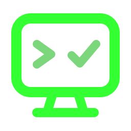

<h1 align="center">
  
  <br>
  <code>tui-test</code>
</h1>

<p align="center">
  <strong>The testing framework for CLI / TUI apps</strong>
</p>

<p align="center">
  <a href="https://tui-test.dev/docs/">Documentation</a> |
  <a href="https://tui-test.dev/docs/install/">Installation</a> |
  <a href="https://github.com/microsoft/tui-test/releases">Releases</a>
</p>

`tui-test` controls, inspects, tests, and records real terminal apps on Windows, Linux, and macOS. Use the CLI or the Rust, Python, JavaScript, and Go libraries for tests and AI agent workflows.

## Demo

<!-- Add a demo video here. -->

## Installation

### CLI

macOS and Linux:

```sh
curl -fsSL https://tui-test.dev/install.sh | sh
```

Windows:

```powershell
irm https://tui-test.dev/install.ps1 | iex
```

Homebrew:

```sh
brew tap microsoft/tui-test https://github.com/microsoft/tui-test
brew install tui-test
```

You can also download a binary from [GitHub Releases](https://github.com/microsoft/tui-test/releases).

### Libraries

| Language | Install |
| --- | --- |
| Rust | `cargo add tui-test-rs` |
| Python | `pip install tui-test` |
| JavaScript / TypeScript | `npm install @microsoft/tui-test` |
| Go | `go get github.com/microsoft/tui-test/bindings/go@latest` |

Libraries run in-process and do not require the CLI. See the [installation guide](https://tui-test.dev/docs/install/) for requirements and supported platforms.

## Examples

Replace `my-app` with the program you want to test.

### CLI

```sh
tui-test run my-app
tui-test expect text "Ready"
tui-test click text "Continue"
tui-test expect text "Done"
tui-test screenshot -o result.svg
tui-test close
```

### Python

```python
import asyncio
from tui_test import TuiTest

async def main():
    async with TuiTest.ephemeral() as terminal:
        await terminal.run("my-app")
        await terminal.get_by_text("Ready").expect()
        await terminal.get_by_text("Continue").click()
        await terminal.get_by_text("Done").expect()

asyncio.run(main())
```

### JavaScript / TypeScript

```js
import { TuiTest } from "@microsoft/tui-test";

const terminal = TuiTest.ephemeral();

try {
  await terminal.run("my-app");
  await terminal.getByText("Ready").expect();
  await terminal.getByText("Continue").click();
  await terminal.getByText("Done").expect();
} finally {
  await terminal.closeQuiet();
}
```

### Rust

```rust
use tui_test::{OpenOptions, Operation, Session};

fn main() -> Result<(), Box<dyn std::error::Error>> {
    let terminal = Session::new("example");
    terminal.open(OpenOptions::default())?;
    terminal.execute(Operation::Submit {
        data: Some("echo hello".into()),
    })?;
    terminal.get_by_text("hello").last().expect()?;
    terminal.close()?;
    Ok(())
}
```

### Go

```go
package main

import (
    "log"

    "github.com/microsoft/tui-test/bindings/go"
)

func main() {
    terminal, err := tuitest.Ephemeral("example", tuitest.ClientOptions{})
    if err != nil {
        log.Fatal(err)
    }
    defer terminal.CloseQuiet()

    if _, err := terminal.Run("my-app", nil, tuitest.SpawnOptions{}); err != nil {
        log.Fatal(err)
    }
    if err := terminal.GetByText("Ready", tuitest.TextSelectorOptions{}).Expect(tuitest.LocatorExpectOptions{}); err != nil {
        log.Fatal(err)
    }
}
```

## Contributing

This project welcomes contributions and suggestions. Most contributions require you to agree to a Contributor License Agreement (CLA) declaring that you have the right to, and actually do, grant us the rights to use your contribution. For details, visit https://cla.opensource.microsoft.com.

When you submit a pull request, a CLA bot will automatically determine whether you need to provide a CLA and decorate the PR appropriately (e.g., status check, comment). Simply follow the instructions provided by the bot. You will only need to do this once across all repos using our CLA.

This project has adopted the [Microsoft Open Source Code of Conduct](https://opensource.microsoft.com/codeofconduct/). For more information see the [Code of Conduct FAQ](https://opensource.microsoft.com/codeofconduct/faq/) or contact [opencode@microsoft.com](mailto:opencode@microsoft.com) with any additional questions or comments.

## Trademarks

This project may contain trademarks or logos for projects, products, or services. Authorized use of Microsoft trademarks or logos is subject to and must follow [Microsoft's Trademark & Brand Guidelines](https://www.microsoft.com/en-us/legal/intellectualproperty/trademarks/usage/general). Use of Microsoft trademarks or logos in modified versions of this project must not cause confusion or imply Microsoft sponsorship. Any use of third-party trademarks or logos are subject to those third-party's policies.
