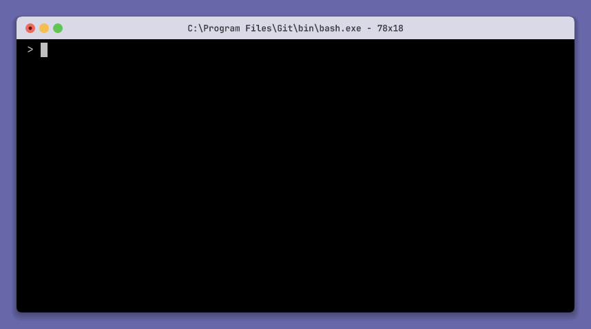

`tui-test monitor` attaches a live terminal viewer to an active CLI daemon session so you can watch automated commands or AI agents drive a TUI app in real time. Because library sessions run in-process without a daemon, `monitor` attaches only to CLI sessions.

## Observe a session

Open or run a session in one terminal, then attach the read-only monitor from another terminal using the same `--session` name:

```sh
tui-test --session demo run my-app
tui-test --session demo monitor
```

| Controlling terminal | Live monitor |
| --- | --- |
|  |  |

Read-only mode mirrors every screen update, locator highlight, window resize, and native scrollback movement (`tui-test scroll up/down/top/bottom`) without sending local keystrokes or clicks to the session.

## Take interactive control

Add `--interactive` when you want to type, paste, or click directly inside the monitored session, for example to complete an authentication prompt or inspect an unfamiliar menu before resuming scripted commands:

```sh
tui-test --session demo monitor --interactive
```

Interactive mode mirrors the session's active keyboard, bracketed-paste, and SGR mouse reporting modes so the child application receives input in the exact protocol it negotiated. If another command scrolled the session into native scrollback history, run `tui-test --session demo scroll bottom` before clicking in interactive mode.

Press `Ctrl+]` to detach from an interactive monitor (`q`, `Esc`, or `Ctrl+C` exits the default read-only monitor) while leaving the background session running. Run `tui-test --session demo close` when you want to terminate the session itself.
