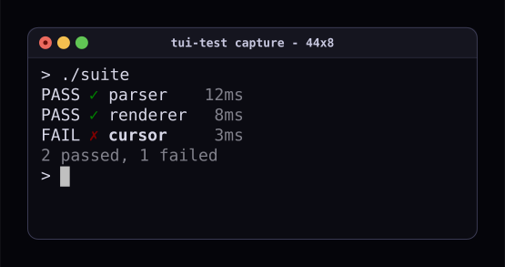

## Create a configuration file

Put `tui-test.toml` in the directory where you invoke the CLI:

```toml
[profiles.default]
scrollback = 10000

[profiles.default.colors]
background = "#000000"
foreground = "#c0c0c0"
red = "#800000"

[recording]
directory = "./casts"

[trace]
mode = "on-failure"
directory = "./traces"

[diagnostics]
screen-history-limit = 10
```

## Select a configuration file

The CLI checks the current directory, the platform config directory, then
`~/.tui-test`. `--config PATH` or `TUI_TEST_CONFIG` selects an explicit file.
An explicitly selected file must exist.

```sh
tui-test open --config ./tui-test.toml
```

## Choose a profile

```toml
[profiles.ci]
scrollback = 500

[profiles.ci.timeouts]
text = 10000
command = 60000
```

```sh
tui-test open --config ./tui-test.toml --profile ci
```

The CLI selects `default` when no profile is specified.
An unknown named profile is an error.

## Profile inheritance and overrides

Profile recording settings inherit omitted keys from the file's `[recording]`
table, including nested style fields. A profile can change only its font size
without losing the file's canvas, padding, or window colors:

```toml
[recording.style]
canvas_background = "#101014"
canvas_padding = 32

[profiles.docs.recording.style]
font_size = 24
```

## Set launch options

Select the shell, backend, size, working directory, and environment at launch:

```sh
tui-test open --shell bash --backend alacritty --cols 100 --rows 40 --cwd .
```

Use `--restart` if the named session is already live and you want to replace it
with these settings.

## Set timeouts

Profile timeouts use milliseconds. Per-launch timeout flags override the profile;
individual operations can supply their own timeout.
See the [timeout reference](/docs/reference/configuration/#timeouts) for classes
and environment defaults.

## Configure scrollback and colors

`scrollback` sets retained history rows. Profile colors define the terminal's
palette, separately from screenshot canvas and title-bar colors.
See [terminal colors](/docs/reference/configuration/#terminal-colors).

## Configure capture styles

```toml
[recording.style]
font_size = 18
canvas_background = "#05050a"
canvas_padding = 30

[recording.style.window]
background = "#15151f"
foreground = "#c8c8e0"
divider = "#2a2a3a"

[recording.style.border]
width = 1
color = "#3a3a52"
radius = 12

[profiles.default.colors]
background = "#0b0b12"
foreground = "#d8d8e8"
```



Failure SVGs and HTML report SVGs use the session's style too.
See [recording style](/docs/reference/configuration/#recording-style) for
fonts, padding, borders, and cursor animation.

## Configure traces and diagnostics

Trace mode is `off`, `on-failure`, or `on`. Configure it before opening the
session. `recording.directory` and `trace.directory` are independent.
Relative directories resolve beside the config file.

`screen-history-limit` controls recent distinct screen retention for failures.
It is separate from the terminal scrollback size.

## Configure language APIs

Pass profiles, timeouts, traces, and artifact options directly to the library
client or test helper:

```js
const terminal = new TuiTest("test", {
  profile: {
    scrollback: 500,
    colors: { foreground: "#ffffff", background: "#000000" },
  },
  timeouts: { text: 10_000, command: 60_000 },
  screenHistoryLimit: 10,
  artifacts: {
    dir: "artifacts/failures",
    onFailure: "all",
    includeRecording: true,
  },
  trace: { mode: "on-failure", directory: "artifacts/traces" },
  recording: { directory: "artifacts/casts" },
});
```

Each [language reference](/docs/getting-started/overview/#choose-an-interface)
lists its option types. Go uses pointer fields to distinguish omission from an
explicit zero or false value.
