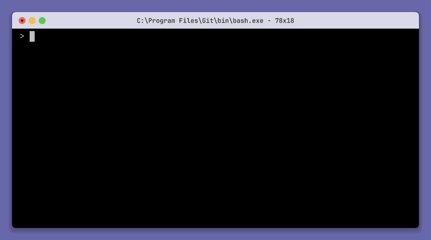

## Watch a session

```sh
tui-test --session demo run my-app
tui-test --session demo monitor
```

The monitor displays a live CLI session. Use the same session name as the
commands controlling the terminal.
It cannot attach to an in-process library session.

| Commands controlling the session | Live monitor |
| --- | --- |
|  |  |

## Interactive mode

```sh
tui-test --session demo monitor --interactive
```

Interactive mode forwards input to the child session.
Use the read-only monitor when you only want to observe automation.

## Keyboard and paste input

Interactive monitoring forwards keyboard and paste input.
It mirrors the session's keyboard and paste modes so the application receives
the input in its expected form.

## Mouse input

Interactive mode forwards supported SGR mouse input.
Mouse input follows the application's enabled mouse modes.
Return to the live viewport before clicking; input while viewing native history
is rejected.

## Terminal modes

The monitor mirrors the session's keyboard, paste, and mouse modes.
Inspect them with `state --json` or `get modes --json` from another terminal.

## Resize and view scrollback

Use `resize COLS ROWS` to change the session grid.
The monitor follows the selected native history viewport, just like screenshots
and visible-text reads. Use `scroll top`, `scroll up`, or `scroll down` from
another command, then `scroll bottom` to return to live output.

## Detach from the monitor

Press `Ctrl+]` to detach from an interactive monitor.
Detaching leaves the session available to subsequent commands.
Use `tui-test --session demo close` when you are finished with the session.
