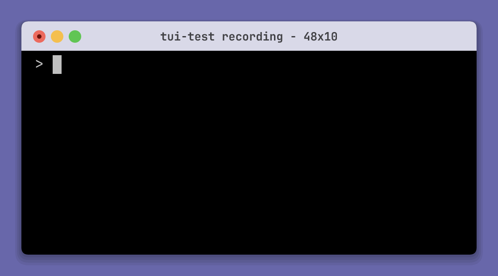

## Choose a recording format

| Extension | Format | Requirements |
| --- | --- | --- |
| `.cast` | Asciinema output stream | A player to replay the cast |
| `.png`, `.apng` | Animated PNG | Raster support and fonts |
| `.gif` | GIF | Raster support and fonts |
| `.mp4` | MP4 | Raster support, fonts, and `ffmpeg` |

`--format` overrides the extension. Rust needs `recording-raster` for APNG,
GIF, and MP4. A `recording-font-jetbrains-mono*` feature also bundles fonts.

## Start and stop a recording

```sh
tui-test run my-app
tui-test expect text "Ready"
tui-test record start demo.gif --fps 30
tui-test click text "Continue"
tui-test expect text "Done"
tui-test record stop
tui-test close
```

`record stop` exports the recording. Library stop methods return its path.
For a script that starts its own shell and records one GIF, use a
[tape](/docs/tools/tapes/).



### Pause and resume

```sh
tui-test record pause
tui-test record resume
```

Pause excludes subsequent time from APNG, GIF, or MP4 while the terminal keeps
running. Resume captures the current screen without intermediate paused output
and restarts the visible cursor phase. Stop also works while paused.
Repeated pause or resume calls return usage errors.

Asciicast pause and resume return usage errors without changing the recording.
Automatic diagnostic recordings and recovery casts remain continuous, including
output during pauses.

## Automatic asciinema recordings

CLI trace mode controls retention: `off` disables tracing, `on-failure` keeps
failed sessions, and `on` keeps every session. Configure it before launch.
Use `get-recording [SESSION] [--config PATH]` to read the automatic cast.

Go's explicit recording options also support always, on-failure, and disabled
modes. Supplied trace options override that selection. Without trace options,
recording-inclusive artifacts promote disabled recording to on-failure.
See the [Go reference](/docs/api/go/#sessions-and-options) for retention after
closure.

## Frame rate, speed, and idle time

Raster recording samples the live terminal at `fps`, defaulting to 30.
It preserves active elapsed time until stop, including quiet periods.
There is no default idle cap or extra final hold.

`--idle-time-limit` caps unchanged visual intervals before `--speed` scales
playback time. An idle limit of zero removes those intervals.
Cursor blink phases share the source screen's idle limit.
Media formats round durations to their supported precision.

## Raster frames and terminal events

Output, resize, and viewport changes appear in the next raster sample.
A state shorter than one sample interval can be missed.
Exports encode these samples without replay through another emulator.
Frames remain in memory until export; identical samples are merged.

GIF export rejects timelines above 100,000 encoded frames, including repeated
frames for long holds. A failed export retains its recovery cast.

Cast files keep timestamped output and resize events. FPS sampling does not
change that stream or add viewport movements. The external player chooses
its own emulator, and the cast does not explicitly represent quiet time after
its last event.

## Fonts and capture styles

Set `[recording.style]` to control fonts, padding, window chrome, and colors.
Cursor blinking requires both `cursor.blink = true` and an application cursor
style that requests blinking. `blink_interval_ms` sets each visible or hidden
phase; 500 ms gives a one-second cycle.
Hidden and off-screen cursors remain hidden. Screenshots remain deterministic.

See the [style reference](/docs/reference/configuration/#recording-style) and
the [Rust recording examples](/docs/api/rust/#screenshots-snapshots-and-recordings).

## Backgrounds and transparency

`--background COLOR` and `--transparent` are mutually exclusive.
Cast recordings do not accept canvas options.
APNG and GIF can use transparency; MP4 cannot.

## MP4 and ffmpeg requirements

Install `ffmpeg` and make it available on `PATH` before starting an MP4 recording.
The other recording formats do not require it.

## Review recorded output before sharing

Recordings can include commands, output, titles, and other data shown in the
terminal. Review both exported media and recovery casts before publishing.
See [failure diagnostics](/docs/tools/failure-diagnostics/) for captured evidence.
